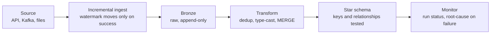

# Muralidhar Reddy Anumandla

**Data Engineer** | Azure, Databricks, Spark, SQL | Richmond, VA (open to relocation)

[LinkedIn](https://www.linkedin.com/in/anumandla-muralidhar-reddy-070576241) · [Email](mailto:anumandlamuralidharreddy@gmail.com) · [Projects](https://github.com/Murali-152002/Data-engineering-My-Projects)

> **Open to Data Engineer roles.** I build and support data pipelines on regulated healthcare data, and I like pipelines
> that are boring to operate: rerunnable, tested, and easy to explain when they fail.

## What I do

Data Engineer at Appex Systems (client: UnitedHealth Group) since June 2025, with an M.S. in Computer Science from
VCU. I work on Azure Data Factory and Databricks pipelines: Kafka-fed ingestion, Delta Lake tables, data quality
checks, migrations and production support.

| What | Result |
|---|---|
| Spark job on about 140M rows | Cut from a 20-hour out-of-memory crash to a 2-4 hour run (about 5-10x faster) |
| Production pipelines | Support 25+ pipelines: trace failures to root cause, rerun transient ones, escalate the rest |
| Legacy consent migration | Tested and reconciled about 3.6M records, source against target, before deployment |
| Duplicate records | Fixed a faulty derived column and merge key in an 8-table Kafka-fed pipeline |
| Data validation | Tested a dedup feature across 20 demographics tables with reusable SQL checks |

## Projects

Personal projects run locally on synthetic or mock data, and each README says which parts are stand-ins for Azure
services. Every project has tests.

**[Orders Lakehouse + LLM Assistant](https://github.com/Murali-152002/Data-engineering-My-Projects/tree/main/orders-lakehouse-adf-dbt-airflow)**
ADF pipeline-as-code with paginated API ingestion and a watermark that only advances on full success, Delta Lake
bronze, a dbt star schema with 19 tests, Airflow orchestration, and a local-LLM assistant that answers pipeline
questions through four read-only tools. SQL that tries to write or drop is refused, and tests prove it.

**[Multi-Source Batch ETL & Data Warehouse](https://github.com/Murali-152002/Data-engineering-My-Projects/tree/main/multi-source-databricks-etl)**
PySpark and Delta Lake medallion pipeline with MERGE upserts, a partitioning + Z-order benchmark and Delta time travel.

**[Cloud-Based Batch ETL Pipeline](https://github.com/Murali-152002/Data-engineering-My-Projects/tree/main/cloud-batch-etl-pipeline)**
ADF watermark incremental copy into Azure SQL, a T-SQL MERGE procedure with a rejected-rows table, and index tuning.

## How I build pipelines

## Tools

| Area | Tools |
|---|---|
| Languages | SQL / T-SQL, Python, PySpark |
| Platform | Azure Databricks, Delta Lake, Unity Catalog, Azure Data Factory, Azure SQL, Kafka, Spark Structured Streaming |
| Modeling and orchestration | dbt, Airflow, dimensional modeling, medallion architecture, incremental loads |
| Engineering | Git and GitHub, pytest, DuckDB, Ollama (local LLMs), Agile/Scrum |

## Right now

- Building: tool-calling LLM assistants with guardrails over pipeline metadata.
- Next: rebuilding my portfolio projects on real public datasets.
- Ask me about: debugging a Spark out-of-memory job, making pipelines safe to rerun, and testing a migration.
